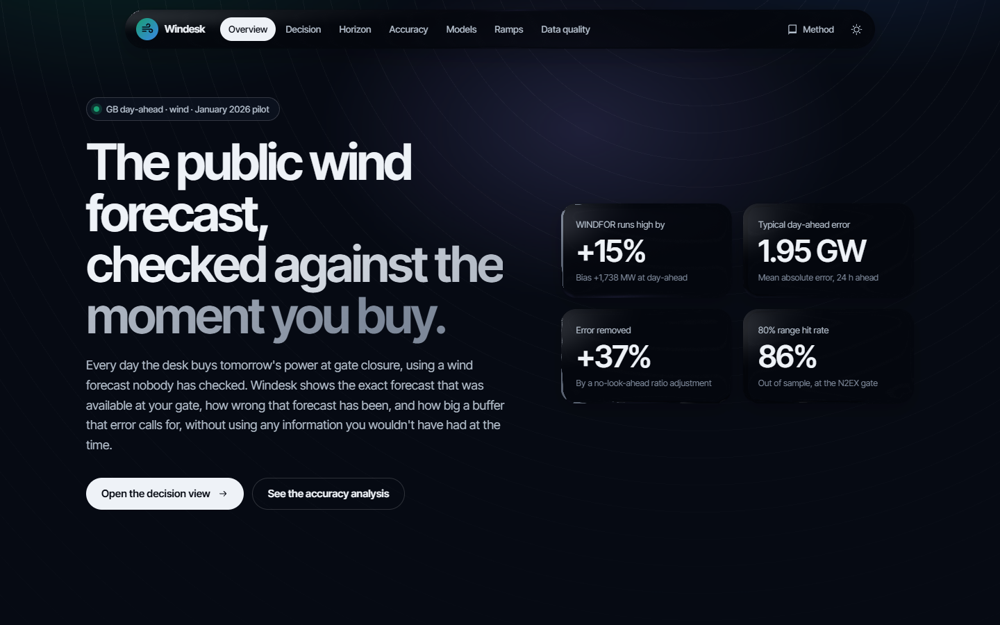
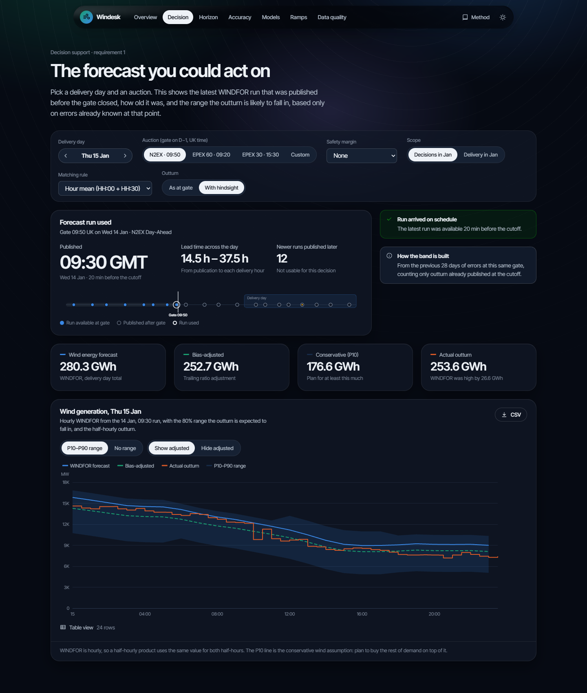
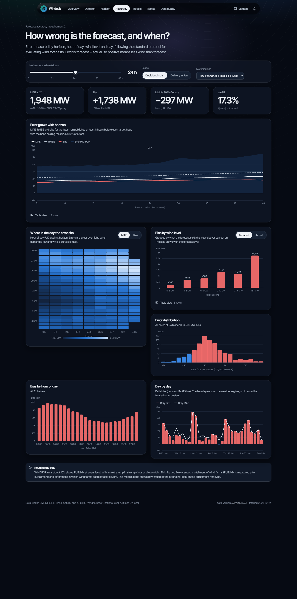

# Windesk: GB wind forecast desk

A web app for a UK utility's day-ahead trading desk. It shows **the national wind forecast as it stood at their auction gate closure**, and **how accurate that forecast has been**, so the desk can buy the power it needs with the forecast error accounted for.

**Live app:** _to be added after the Heroku deploy (see [Deploy](#deploy))_



## What it answers

| Requirement | Where | How |
|---|---|---|
| 1. The latest renewable forecast available when the decision is made | **Decision** | For a delivery day and an auction (N2EX 09:50, EPEX 60-min 09:20, EPEX half-hourly 15:30, or a custom gate and margin), it picks the newest WINDFOR run published before the gate. It shows the run's age, late or missed runs, a P10–P90 range built only from errors known at the gate, a bias-adjusted line, and, with hindsight, the outturn. |
| 2. Quantify forecast accuracy | **Horizon**, **Accuracy**, **Models**, **Ramps** | Forecast vs actual at any horizon from 0 to 48 h; bias, MAE, RMSE, WAPE and nMAE by horizon, hour of day, wind level and day; out-of-sample skill of bias corrections and the calibration of the 80% band; ramp-event hit rates. |
| Trust | **Data quality**, Methodology drawer, CSV export | Late or missing runs, settlement-period completeness that accounts for clock changes, publication lag, ingest anomalies. Every response and export is stamped with the `data_version` of the raw snapshot. |

### Headline findings (January 2026)

- **WINDFOR runs about 15% above metered outturn**, with a bias of +1.74 GW at day-ahead. The gap is proportional and grows to +2.7 GW when the forecast says over 15 GW. Likely causes are curtailment and differences in which wind farms each dataset covers.
- **Error grows with horizon:** MAE is 1.69 GW at 1 h, 1.95 GW at 24 h and 2.31 GW at 48 h.
- **Most of the error can be planned around:** a trailing ratio adjustment that only uses data available at each gate cuts MAE by **37%** out of sample. The 80% band covers **86%** of hours.

Details: [`docs/findings.md`](docs/findings.md).

| Decision view | Accuracy |
|---|---|
|  |  |

## Architecture

```
Elexon Insights API ── windesk fetch ──► data/seed/  raw JSON.gz + manifest (SHA-256, data_version)   [committed]
                                              │  windesk build  (offline, deterministic, verifies hashes)
                                              ▼
                                   DuckDB warehouse (PK + CHECK constraints)
                                              │  load once at startup (Parquet hand-off)
                                              ▼
              domain/  pure functions on Polars: as-of selection · matching · metrics · models · ramps · quality
                                              │
              services/  composes domain into answers, memoised per (data_version, params)
                                              │
              api/  FastAPI + Pydantic v2 (typed contract → OpenAPI → generated TypeScript types)
                                              │  same origin
              frontend/  React 19 + TS · TanStack Query · ECharts (SVG) · Lenis + liquidGL
```

One rule sits underneath everything ([ADR 0001](docs/adr/0001-point-in-time-selection.md)): for each target hour, use the run with the latest `publish_time ≤ cutoff` that contains that hour. The cutoff is either `target − horizon` or `gate closure − margin`. Corrections and bands apply the same rule to outturn, using `FUELHH.publishTime`.

## Repository layout

```
.
├── backend/                    Python 3.13 · uv
│   ├── src/windesk/
│   │   ├── ingest/             elexon.py (httpx + tenacity retries), snapshot.py (hashed raw files),
│   │   │                       normalize.py (schema contract + issue log), pipeline.py
│   │   ├── store/              warehouse.py (DuckDB build, atomic), repository.py (read side)
│   │   ├── domain/             pure, I/O-free: clock.py (GB settlement time), auctions.py, asof.py,
│   │   │                       matching.py, pairs.py, metrics.py, models.py, ramps.py, quality.py
│   │   ├── services/           analytics.py (composition + memoisation)
│   │   ├── api/                app.py (factory, middleware, SPA), routes/, schemas.py (contract), deps.py
│   │   ├── config.py           pydantic-settings (WINDESK_* env vars)
│   │   ├── logs.py             structlog (JSON in prod)
│   │   └── cli.py              windesk fetch | build | openapi | serve
│   ├── tests/                  unit/ property/ (Hypothesis) integration/ (respx fixtures, DuckDB
│   │                           differential, golden values) api/ ; fixtures/ = recorded Elexon responses
│   ├── data/seed/              committed raw snapshot (Dec 2025 – 1 Feb 2026, ~220 KB)
│   ├── openapi.json            generated API contract (CI checks it is current)
│   └── pyproject.toml, uv.lock ruff, mypy --strict, pytest, coverage gate 85%
├── frontend/                   React 19 · TypeScript (strict) · Vite 8
│   └── src/
│       ├── api/                schema.d.ts (generated), client.ts, hooks.ts (TanStack Query), types.ts
│       ├── app/                AppShell (glass nav), router (code-split pages), MethodologyDrawer
│       ├── pages/              Overview, Decision, Explorer (horizon), Accuracy, Models, Ramps, Quality
│       ├── charts/             EChart wrapper + options/ (pure option builders, unit-tested)
│       ├── components/         ui/ (Card, StatTile, Segmented, Slider, Callout, DataTable…),
│       │                       RunTimeline, DayStepper, ScopeFilters, GlassPanel
│       ├── motion/             Lenis + liquidGL on one frame loop, glass adapter, Reveal
│       ├── theme/, styles/     design tokens (validated palettes), dark/light themes
│       ├── state/filters.ts    URL-backed filter state (shareable views)
│       └── lib/format.ts       Europe/London formatting, UK wall-clock time for charts
├── docs/
│   ├── research.md             pre-implementation research and design brief
│   ├── findings.md             what the data showed
│   ├── adr/                    architecture decision records 0001–0006
│   └── images/                 screenshots
├── Dockerfile                  multi-stage: build UI → install backend + bake warehouse → slim non-root runtime
├── docker-compose.yml          run the production image locally
├── heroku.yml                  Heroku container-stack deploy
└── .github/workflows/ci.yml    lint, types, tests, contract sync, Docker build + smoke test
```

## Running it

### With Docker (recommended: same image as production)

```bash
docker compose up --build
# open http://localhost:8000
```

### Local development

Prerequisites: Python 3.13 with [uv](https://docs.astral.sh/uv/), and Node 22.

```bash
# backend: API on :8000
cd backend
uv sync
uv run windesk build          # builds data/warehouse.duckdb from the committed snapshot
uv run windesk serve          # reloads on change

# frontend: app on :5173, proxies /api to :8000
cd frontend
npm ci
npm run dev
```

Refresh the data from Elexon (network): `uv run windesk fetch && uv run windesk build`. This produces a new `data_version`.

### Quality gates (all run in CI)

```bash
cd backend  && uv run ruff check src tests && uv run ruff format --check src tests && uv run mypy && uv run pytest
cd frontend && npm run typecheck && npm run lint && npm run format:check && npm test && npm run build
```

- **Backend:** 113 tests (plus 2 opt-in live checks), 95% branch coverage, with a 90% gate. They include property-based tests of the no-look-ahead rule, a metamorphic test that corrupting future outturn never changes a day's outputs, a differential test against DuckDB's `ASOF JOIN`, clock-change tests for days with 46 and 50 settlement periods, golden values for the headline numbers, and a reconciliation against Elexon's own server-side forecast views (the snapshot matches its earliest run for every hour; a live re-check runs with `pytest -m network`).
- **Frontend:** 37 tests covering formatting and UK time, the API client, the chart option builders (e.g. the heatmap colours the metric, not the sample count), UI components, and the Decision page against recorded API responses.
- **Contract:** CI regenerates `openapi.json` and the TypeScript types, and fails if they differ from what is committed.

### Performance

Measured in-process on the January snapshot:

| | Before | After |
|---|---|---|
| Accuracy view, first request | 667 ms | 8 ms (pre-warmed at startup); 59 ms for an unwarmed horizon |
| Accuracy curve (49 horizons) | 49 as-of joins, 819 ms | one join, 39 ms, identical results |
| Any view, repeat request | 7–38 ms | 5–15 ms |
| Docker image | 607 MB | 498 MB (DuckDB and sourcemaps not shipped) |
| Overview first paint | waits for ECharts (+226 kB gzip) | ECharts loads lazily, after the text renders |

## API

Interactive docs at `/docs`. Every JSON response is `{ data, meta: { data_version, generated_at, params } }`.

| Endpoint | Purpose |
|---|---|
| `GET /api/meta` | coverage, data version, auction and scope presets |
| `GET /api/decision?delivery_date&auction\|gate_local&margin_min&matching` | the run available at the gate, its age, warnings, P10–P90 band, adjusted line, outturn |
| `GET /api/revisions?delivery_date&auction\|gate_local&margin_min&matching` | every run that covered the day, which were available at the gate, and the outturn |
| `GET /api/horizon?first&last&horizon_h&matching` | forecast made ≥ h hours ahead vs actual |
| `GET /api/accuracy?first&last&horizon_h&matching` | error curve, hour × horizon heatmap, by wind level, histogram, daily |
| `GET /api/models?first&last&auction&matching` | out-of-sample skill and band calibration |
| `GET /api/ramps?first&last&horizon_h&threshold_mw&window_h&tolerance_h` | ramp hit, miss and false-alarm rates |
| `GET /api/quality?first&last` | data-quality checks |
| `GET /api/export/pairs.csv?first&last&(auction\|horizon_h)` | the exact pairs behind any metric |
| `GET /healthz` | liveness and data version |

## Scope interpretation

"Purchase decisions made in January 2026" is read as **gate closures on 1–31 January**, which means **delivery days 2 January – 1 February**. Forecasts and actuals are fetched from December so that trailing statistics on 1 January only use genuinely earlier data. The UI offers "Delivery in January" as an alternative scope. Only the two Elexon datasets in the brief are used: `FUELHH` (fuel type `WIND`) and `WINDFOR`.

## Deploy

The app ships as a single container on Heroku's container stack ([ADR 0005](docs/adr/0005-deployment-single-container.md)):

```bash
heroku create <app-name>
heroku stack:set container -a <app-name>
git push heroku main          # builds the Dockerfile via heroku.yml
```

No add-ons or config vars are required. Use a Basic dyno for reviews, because Eco dynos sleep after 30 minutes idle.

## Design decisions

[ADR 0001](docs/adr/0001-point-in-time-selection.md) as-of selection ·
[0002](docs/adr/0002-storage-snapshot-duckdb-polars.md) storage ·
[0003](docs/adr/0003-matching-rule.md) matching rule ·
[0004](docs/adr/0004-out-of-sample-models.md) out-of-sample models ·
[0005](docs/adr/0005-deployment-single-container.md) deployment ·
[0006](docs/adr/0006-ui-design-system.md) UI design system ·
[0007](docs/adr/0007-lessons-from-comparable-tools.md) lessons from comparable tools ·
[competitive review](docs/competitive-review.md) of 13 comparable submissions

## Limitations and next steps

- Testing the bias cause needs NESO balancing-action (BOA) volumes, which are outside the brief's data scope.
- A multiplicative error band would likely calibrate better than the additive one (86% vs 80% nominal). It is not tuned on the evaluation month.
- WINDFOR is hourly, so half-hourly products reuse the hourly value.
- January is GMT. Clock-change logic is covered by tests but not exercised by this month's data.

## Use of AI tools

This project was built with **Claude Code** (Anthropic) as a pair programmer. It was used for research synthesis, code, tests, documentation and visual QA from headless-browser screenshots. Every result was run and checked against the live Elexon data and the test suite. The design decisions, the data investigation (`docs/findings.md`) and the bugs found during review are recorded in the ADRs.

## Credits

Data: [Elexon BMRS](https://bmrs.elexon.co.uk/) (`FUELHH`, `WINDFOR`). Smooth scrolling: [Lenis](https://github.com/darkroomengineering/lenis) (MIT). Liquid glass: [liquidGL](https://github.com/naughtyduk/liquidGL) (MIT). Charts: [Apache ECharts](https://echarts.apache.org/).
